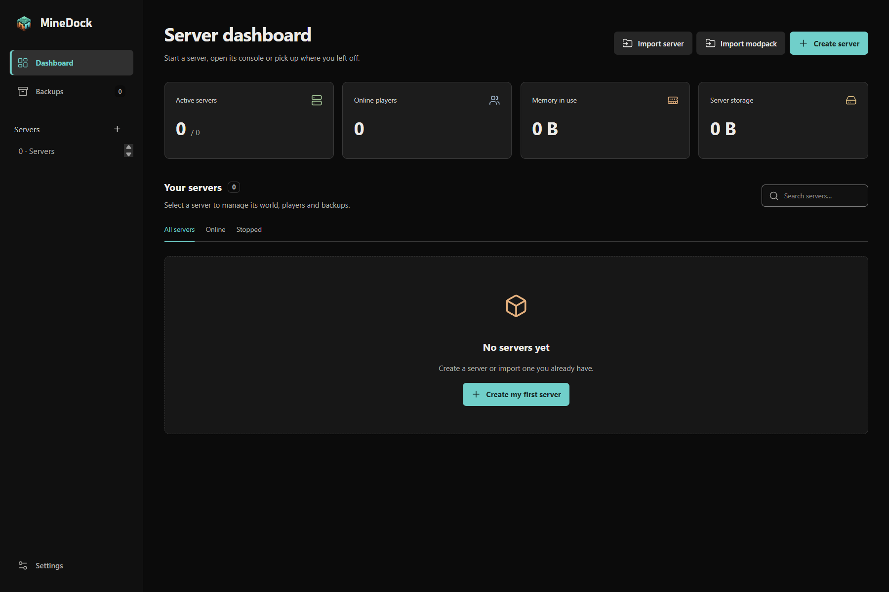
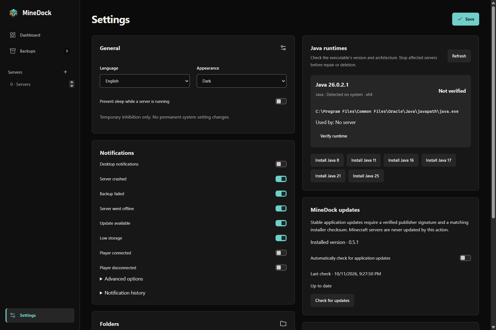

# MineDock 0.5.1 native captures

Captured on 11 October 2026 from the actual Windows x64 application extracted from the signed, tagged GitHub Actions Portable build. The publicly downloaded Portable matches that exact build: SHA-256 `6710c2f14851df8964c5ce8d8c65f44ac408d27f8af6419bca936d7d6be403c8`. The app executable's owner signature and file integrity were verified separately. [Release evidence](../../validation-records/0.5.1-release.json).

These images use the real Electron window, preload, core and SQLite services with an isolated empty profile, English and dark appearance. The native content viewport is 1440 × 960 logical pixels; PNG output is 1800 × 1200 pixels at the Windows display scale. There are no servers, connected players or private game resources in this profile. The Settings view includes an actual locally detected system Java runtime, not a managed server runtime. It shows installed version **0.5.1** and **Up to date** after querying the real public GitHub release feed without interception.

| Dashboard                                                      | Settings and public update check                              |
| -------------------------------------------------------------- | ------------------------------------------------------------- |
|  |  |

The interface and administration features are retained from 0.5.0. Other gallery images keep their explicit 0.5.0 or 0.4.1 provenance; these two captures do not imply that every historical image was recreated. No screenshot is presented as a Minecraft gameplay session.
